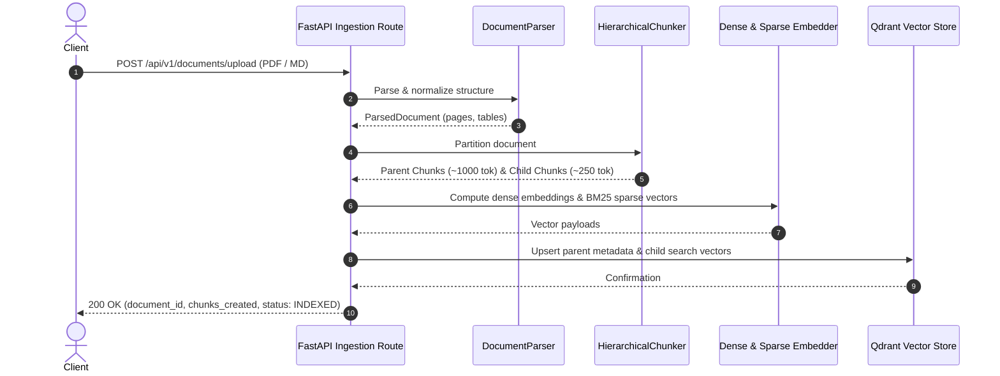

# RAG Stream

> Production-Grade Advanced RAG (Retrieval-Augmented Generation) engine featuring Corrective RAG (CRAG), hybrid vector + sparse BM25 indexing with Reciprocal Rank Fusion, hierarchical chunking, and streaming attributed citations.


---

## Architecture Overview

RAG Stream is designed to overcome common pitfalls of naive RAG architectures—such as retrieval loss, hallucinations, context fragmentation, and unverified outputs.

```mermaid
flowchart TD
    subgraph Ingestion ["Ingestion Pipeline"]
        A["Raw Document (PDF / MD / TXT)"] --> B["DocumentParser & Normalizer"]
        B --> C["HierarchicalChunker (Parent-Child)"]
        C --> D["Dense Vector Embedder (384-dim)"]
        C --> E["Sparse Tokenizer (BM25)"]
        D --> F[("Qdrant Hybrid Vector Store")]
        E --> F
    end

    subgraph Retrieval ["Retrieval & Generation Pipeline"]
        Q["User Query"] --> QR["Query Normalization & Expansion"]
        QR --> H_Dense["Dense Vector Search (ANN)"]
        QR --> H_Sparse["Sparse Keyword Search (BM25)"]
        H_Dense --> RRF["Reciprocal Rank Fusion (RRF k=60)"]
        H_Sparse --> RRF
        RRF --> CE["Cross-Encoder Reranker"]
        CE --> CRAG{"Corrective RAG Gate (tau >= 0.35)"}
        CRAG -- "Below Threshold" --> FB["Graceful Fallback / Clarification"]
        CRAG -- "Sufficient Confidence" --> CTX["Parent Context Assembly"]
        CTX --> LLM["LLM Generation Engine"]
        LLM --> SSE["Streaming SSE with Attributed Citations"]
    end
```



### Ingestion Sequence



---

## Key Features

* **Hierarchical Chunking (Parent-Child Strategy):** Child chunks (~250 tokens, 50 token overlap) are indexed for precise semantic matching, while broader parent chunks (~1000 tokens) are retrieved to provide context to the LLM.
* **Hybrid Search with Reciprocal Rank Fusion (RRF):** Combines dense vector similarity with sparse BM25 keyword matching using reciprocal rank fusion:
  $$\text{RRF}(d) = \sum_{m \in M} \frac{1}{k + r_m(d)} \quad (k=60)$$
* **Cross-Encoder Reranker:** Scores query-passage pairs simultaneously to eliminate false-positive candidates before generation.
* **Corrective RAG (CRAG) Gate:** Evaluates candidate confidence against a threshold ($\tau_{min} = 0.35$). If confidence is insufficient, triggers an explicit fallback rather than producing hallucinated responses.
* **Streaming Attributed Citations:** Delivers answers token-by-token over Server-Sent Events (SSE) with exact document and page-level citations (`[Doc: <filename>, Page <number>]`).
* **Zero-Dependency In-Memory Mode:** Operates out of the box with in-memory Qdrant for testing, and scales to clustered Qdrant deployments in production.

---

## Live Terminal Demonstration


---

## Quickstart

### Prerequisites
* Python 3.11+ or Docker & Docker Compose
* `git`

### Option 1: Local Development Environment

```bash
# 1. Clone repository
git clone https://github.com/dawidbera/rag-stream.git
cd rag-stream

# 2. Create virtual environment
python3 -m venv .venv
source .venv/bin/activate

# 3. Install dependencies in editable mode
pip install -e .[dev]

# 4. Run tests
pytest -v

# 5. Start the application
uvicorn rag_stream.api.app:app --host 0.0.0.0 --port 8000 --reload
```

### Option 2: Docker Compose (Full Stack with Qdrant)

```bash
docker compose up -d
```

Check application health:
```bash
curl -s http://localhost:8000/health
```

---

## API Reference

### 1. Ingest Document
Upload a PDF, Markdown, or plain text document for parsing, hierarchical chunking, and indexing.

```bash
curl -X POST "http://localhost:8000/api/v1/documents/upload" \
  -F "file=@sample_report.pdf" \
  -F "collection_name=finance_reports" \
  -F 'metadata={"department": "Finance", "fiscal_year": 2025}'
```

**Response:**
```json
{
  "document_id": "doc_8f1b2c34",
  "filename": "sample_report.pdf",
  "chunks_created": 42,
  "status": "INDEXED"
}
```

### 2. Query Documents (Standard)
Execute question-answering with hybrid retrieval, reranking, and attributed citations.

```bash
curl -X POST "http://localhost:8000/api/v1/query" \
  -H "Content-Type: application/json" \
  -d '{
    "query": "What were the total cloud infrastructure expenses in Q3?",
    "collection_name": "finance_reports",
    "top_k": 5,
    "enable_reranking": true
  }'
```

**Response:**
```json
{
  "query": "What were the total cloud infrastructure expenses in Q3?",
  "answer": "Based on the analyzed documentation, total cloud infrastructure expenses reached $4.2M in Q3 2025 [Doc: sample_report.pdf, Page 1].",
  "sources": [
    {
      "document_id": "doc_8f1b2c34",
      "filename": "sample_report.pdf",
      "chunk_id": "chunk_33a1",
      "score": 0.892,
      "content_excerpt": "total cloud infrastructure expenses reached $4.2M, driven primarily by Kubernetes cluster scaling...",
      "page_number": 1
    }
  ],
  "latency_ms": 18
}
```

### 3. Query Documents (Streaming SSE)
Stream token outputs in real time via Server-Sent Events (`text/event-stream`).

```bash
curl -N -X POST "http://localhost:8000/api/v1/query/stream" \
  -H "Content-Type: application/json" \
  -d '{
    "query": "Explain Kubernetes cluster scaling costs",
    "collection_name": "finance_reports"
  }'
```

---

## Technical Lessons Learned (Gotchas)

> [!NOTE]
> **In-Memory Qdrant Isolation:** In `qdrant-client` (v1.12+), initializing `QdrantClient(":memory:")` creates an isolated in-memory SQLite/storage context per instance. To maintain consistency across ingestion and query services in standalone environments without external Redis or shared state, a singleton factory pattern (`get_vector_store()`) ensures that both routes share the same in-memory collection space.

> [!TIP]
> **RRF Constant Selection ($k=60$):** In hybrid search, dense ANN score magnitudes (cosine similarities between 0 and 1) cannot be directly summed with unbounded BM25 scores. Reciprocal Rank Fusion ($1 / (k + \text{rank})$) standardizes ranking distributions. Setting $k=60$ prevents dominant outliers from either search modality while retaining high top-rank discriminability.

> [!WARNING]
> **Parent Chunk Isolation During Retrieval:** Parent chunks contain broad context (~1000 tokens) that can dilute vector search precision. RAG Stream isolates parent chunks by storing them with `is_parent: True` and zeroed query vectors, indexing only child chunks for retrieval. When a child matches, its linked parent content is retrieved to construct the LLM prompt.

---

## Kubernetes Deployment (Helm)

A production-ready Helm chart is provided under `deploy/helm/rag-stream`.

```bash
# Lint the chart
helm lint deploy/helm/rag-stream

# Dry-run installation
helm install --dry-run --debug rag-stream deploy/helm/rag-stream
```

---

## License

This project is licensed under the Apache-2.0 License.
